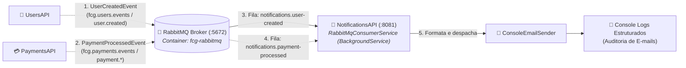

# FIAP Cloud Games - Fase 02 - Microsserviço NotificationsAPI (`fcg-fase-02--notifications`)

[](https://dotnet.microsoft.com/)
[](https://www.rabbitmq.com/)
[](https://www.docker.com/)

> 🎓 **Projeto Acadêmico FIAP**  
> Este microsserviço faz parte do projeto de conclusão de curso da **"Pós-Tech: Arquitetura de Sistemas .NET"** da **FIAP**.  
> O objetivo da solução é projetar e implementar um ecossistema distribuído de nuvem voltado para uma plataforma de jogos digitais (*Cloud Gaming*), aplicando os mais modernos padrões de mensageria assíncrona em **.NET 10**.

---

> 🌐 **Documentação Principal e Orquestração do Ecossistema:**  
> A visão geral de toda a solução distribuída, a topologia de pastas, a arquitetura de redes e o guia para inicialização unificada de todos os microsserviços e bancos de dados estão centralizadas no repositório de **Orquestração**:  
> 👉 **[🚀 Acessar Ponto de Partida & Orquestração (`fcg-fase-02--orchestration`)](https://github.com/idgrego/fcg-fase-02--orchestration)**

---

## 📑 Sumário

- [1. O Microsserviço NotificationsAPI](#1-o-microsserviço-notificationsapi)
  - [1.1. Responsabilidades de Negócio](#11-responsabilidades-de-negócio)
  - [1.2. Diagrama de Integração e Consumo](#12-diagrama-de-integração-e-consumo)
- [2. Tecnologias & Decisões Arquiteturais](#2-tecnologias--decisões-arquiteturais)
- [3. Como Executar a NotificationsAPI](#3-como-executar-a-notificationsapi)
  - [3.1. Execução Integrada via Docker Compose (Recomendado)](#31-execução-integrada-via-docker-compose-recomendado)
  - [3.2. Execução Individual (.NET CLI & Docker Local)](#32-execução-individual-net-cli--docker-local)
- [4. Mensageria Assíncrona & Eventos Consumidos](#4-mensageria-assíncrona--eventos-consumidos)
  - [4.1. Evento: `UserCreatedEvent` (Boas-Vindas)](#41-evento-usercreatedevent-boas-vindas)
  - [4.2. Evento: `PaymentProcessedEvent` (Comprovante / Recusa)](#42-evento-paymentprocessedevent-comprovante--recusa)
- [5. Endpoint de Integridade (HealthCheck)](#5-endpoint-de-integridade-healthcheck)
- [6. Documentação Técnica Detalhada (`/docs`)](#6-documentação-técnica-detalhada-docs)

---

## 1. O Microsserviço NotificationsAPI

A **NotificationsAPI** atua como a central de comunicações transacionais do ecossistema **FIAP Cloud Games**, consumindo eventos de negócio emitidos pelos outros microsserviços via **RabbitMQ** e despachando e-mails formatados.

### 1.1. Responsabilidades de Negócio
- **E-mail de Boas-Vindas:** Disparado após o cadastro bem-sucedido de um novo usuário na `UsersAPI`.
- **E-mail de Confirmação de Compra:** Notificação com detalhes do pedido e recibo quando a transação é aprovada pela `PaymentsAPI`.
- **E-mail de Alerta de Pagamento Rejeitado:** Aviso imediato ao jogador contendo o motivo da recusa financeira e orientações para troca do método de pagamento.
- **Logs Estruturados de Auditoria:** Impressão no console do contêiner com timestamps, destinatário, assunto e corpo para auditoria e observabilidade.

### 1.2. Diagrama de Integração e Consumo



---

## 2. Tecnologias & Decisões Arquiteturais

- **Runtime & Plataforma:** .NET 10 (`net10.0`), C# 14, Solution moderna `.slnx`.
- **Arquitetura de Processamento Assíncrono:** Aplicação construída como Web API enxuta executando serviços de segundo plano contínuos (`BackgroundService`).
- **Mensageria com RabbitMQ 7.x:** Consumo reativo via `AsyncEventingBasicConsumer` com confirmação manual (`BasicAckAsync`), prefetch controlado (`BasicQosAsync(1)`) e rejeição sem loop infinito (`BasicNackAsync(requeue: false)`).
- **Padrão Tolerant Reader:** Os DTOs de eventos possuem apenas os campos estritamente necessários para a montagem dos e-mails, permitindo que os microsserviços produtores evoluam seus esquemas sem quebrar as notificações.
- **Containerização Segura:** Dockerfile Multi-stage com usuário não-root nativo (`USER app`) na porta `8080` (mapeada para `8081` no host).

---

## 3. Como Executar a NotificationsAPI

### 3.1. Execução Integrada via Docker Compose (Recomendado)

Na pasta de orquestração:
```powershell
cd ../fcg-fase-02--orchestration
docker compose up -d --build
```

Acompanhe os e-mails sendo disparados nos logs em tempo real:
```powershell
docker compose logs -f notifications-api
```

---

### 3.2. Execução Individual (.NET CLI & Docker Local)

1. **Subir o RabbitMQ:**
   ```powershell
   docker run -d --name rabbitmq -p 5672:5672 -p 15672:15672 rabbitmq:3-management
   ```

2. **Executar a NotificationsAPI:**
   Na pasta `fcg-fase-02--notifications`:
   ```powershell
   dotnet run --project src/FCG02.NotificationsAPI.API
   ```

---

## 4. Mensageria Assíncrona & Eventos Consumidos

### 4.1. Evento: `UserCreatedEvent` (Boas-Vindas)
- **Exchange:** `fcg.users.events` (Topic)
- **Fila:** `notifications.user-created`
- **Routing Key:** `user.created`
- **Ação:** Envia e-mail de boas-vindas para o novo jogador e emite `BasicAck`.

```json
{
  "userId": "550e8400-e29b-41d4-a716-446655440000",
  "name": "Bruce Wayne",
  "email": "bruce.wayne@waynecorp.com",
  "role": "Gamer",
  "createdAt": "2026-10-29T10:00:00Z"
}
```

### 4.2. Evento: `PaymentProcessedEvent` (Comprovante / Recusa)
- **Exchange:** `fcg.payments.events` (Topic)
- **Fila:** `notifications.payment-processed`
- **Routing Key Pattern:** `payment.*`
- **Ação:**
  - Se `Status: Approved` $\rightarrow$ Envia comprovante de compra com instruções de acesso.
  - Se `Status: Rejected` $\rightarrow$ Envia alerta de erro de pagamento com a justificativa (`Reason`).

---

## 5. Endpoint de Integridade (HealthCheck)

A NotificationsAPI expõe um endpoint HTTP leve para sondagem por orquestradores:

| Método | Rota | Descrição | Resposta |
|---|---|---|---|
| `GET` | `/health` | Healthcheck de integridade do serviço | `200 OK` (`{ "status": "Healthy", "service": "NotificationsAPI" }`) |

---

## 6. Documentação Técnica Detalhada (`/docs`)

Para um aprofundamento específico na arquitetura da NotificationsAPI, consulte os documentos na pasta [`/docs`](docs/index.md):

- **[📑 Índice da Documentação Técnica](docs/index.md)**
- **[🏛️ Arquitetura do Serviço e Tolerant Reader](docs/architecture.md)**
- **[⚙️ Serviços de Mensageria e Envio de E-mails](docs/services.md)**
- **[🐳 Containerização e Docker Multi-stage](docs/docker.md)**
- **[☸️ Orquestração com Kubernetes](docs/k8s.md)**
