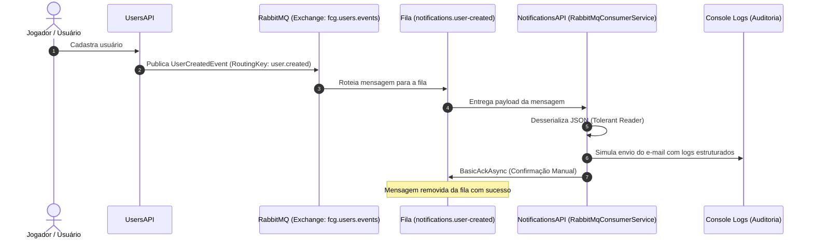

# NotificationsAPI - Documentação de Arquitetura

A **NotificationsAPI** é o microsserviço responsável pelo processamento assíncrono de notificações e comunicações transacionais por e-mail da plataforma **FIAP Cloud Games**.

---

## 📑 Sumário

- [1. Visão Geral e Responsabilidades](#1-visão-geral-e-responsabilidades)
- [2. Estrutura da Solução e Projetos](#2-estrutura-da-solução-e-projetos)
- [3. Arquitetura de Consumo Assíncrono (EDA & RabbitMQ)](#3-arquitetura-de-consumo-assíncrono-eda--rabbitmq)
  - [3.1. Padrão Tolerant Reader](#31-padrão-tolerant-reader)
  - [3.2. Confirmação Manual e Tolerância a Falhas](#32-confirmação-manual-e-tolerância-a-falhas)
- [4. Topologia do RabbitMQ](#4-topologia-do-rabbitmq)
- [5. Navegação](#5-navegação)

---

## 1. Visão Geral e Responsabilidades

- **Consumo de Eventos de Usuários:** Escuta o evento `UserCreatedEvent` publicado pela `UsersAPI` e simula o disparo de e-mails de boas-vindas com dados da conta.
- **Consumo de Eventos de Pagamento:** Escuta o evento `PaymentProcessedEvent` da `PaymentsAPI` para confirmação de compra ou notificação de recusa.
- **Logs Estruturados para Auditoria:** Registra todas as mensagens no console com formato enriquecido (Destinatário, Assunto, Data/Hora UTC e Corpo da Mensagem).

---

## 2. Estrutura da Solução e Projetos

A solução adota a extensão moderna `.slnx` e Web API com Background Worker em **.NET 10 (`net10.0`)**:

```text
fcg-fase-02--notifications/
├── FCG02.NotificationsAPI.slnx          # Solução .NET 10 no formato moderno slnx
├── README.md                            # Visão geral do repositório e guia de execução
├── docs/                                # Documentação técnica
│   ├── index.md                         # Índice geral da documentação
│   └── architecture.md                  # Visão arquitetural do serviço
├── src/
│   └── FCG02.NotificationsAPI.API/      # Web API + Background Worker Service
│       ├── Models/                      # DTOs de eventos e mensagens (Tolerant Reader)
│       │   ├── UserCreatedIntegrationEvent.cs
│       │   └── EmailMessage.cs
│       ├── Services/                    # Serviços de envio e consumidor RabbitMQ
│       │   ├── IEmailSender.cs
│       │   ├── ConsoleEmailSender.cs
│       │   └── RabbitMqConsumerService.cs
│       ├── appsettings.Development.json # Configuração de broker e filas
│       ├── appsettings.json
│       ├── FCG02.NotificationsAPI.API.csproj
│       └── Program.cs                   # Inicialização e Hosted Services
└── tests/                               # Testes da suíte de notificações
```

---

## 3. Arquitetura de Consumo Assíncrono (EDA & RabbitMQ)



### 3.1. Padrão Tolerant Reader
A `NotificationsAPI` não compartilha assemblies nem DLLs de domínio com a `UsersAPI`. Ela declara seu próprio contrato (`UserCreatedIntegrationEvent`) contendo apenas os campos estritamente necessários para o envio do e-mail. Isso garante desacoplamento de contratos e impede que mudanças em outros serviços quebrem o consumidor.

### 3.2. Confirmação Manual e Tolerância a Falhas
O consumidor opera com `autoAck: false`. A confirmação da mensagem (`BasicAckAsync`) ocorre exclusivamente após o processamento com sucesso. Caso ocorra uma falha irrecuperável, a mensagem pode ser rejeitada via `BasicNackAsync` para ser roteada para uma Dead Letter Queue (DLQ).

---

## 4. Topologia do RabbitMQ

| Recurso | Nome | Tipo / Configuração |
|---|---|---|
| **Exchange** | `fcg.users.events` | `Topic` (Durable) |
| **Routing Key** | `user.created` | Filtro para cadastro de novos usuários |
| **Fila** | `notifications.user-created` | `Durable` |

---

## 5. Navegação

- 🏠 **[Voltar para o Índice da Documentação (index.md)](index.md)**
- 🚀 **[Voltar para o README Principal](../README.md)**
