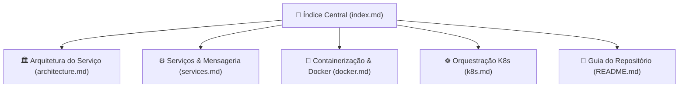

# NotificationsAPI - Índice da Documentação Técnica

Bem-vindo à documentação técnica oficial da **NotificationsAPI** (`fcg-fase-02--notifications`), microsserviço de comunicações assíncronas e disparo de e-mails transacionais do ecossistema **FIAP Cloud Games**.

---

## 🗺️ Mapa de Documentação

---

## 📚 Documentos Disponíveis

1. **[🏛️ Arquitetura do Serviço (`architecture.md`)](architecture.md)**
   - Papel do microsserviço no ecossistema FIAP Cloud Games.
   - Padrão *Tolerant Reader* e desacoplamento de contratos.
   - Diagrama de sequência de consumo e confirmação manual com RabbitMQ.
   - Estrutura de projetos (`FCG02.NotificationsAPI.slnx` e `FCG02.NotificationsAPI.API`).

2. **[⚙️ Serviços de Mensageria e Envio de E-mails (`services.md`)](services.md)**
   - Implementação do `RabbitMqConsumerService` (`BackgroundService`).
   - Ciclo de recebimento, QoS/prefetch e `BasicAckAsync`.
   - Abstração `IEmailSender` e implementação do `ConsoleEmailSender`.
   - Prevenção de loops infinitos (*Poison Messages*).

3. **[🐳 Containerização com Docker (`docker.md`)](docker.md)**
   - Multi-stage build com .NET 10.
   - Execução não-root segura com `USER app`.
   - Integração ao Docker Compose e healthcheck do broker.

4. **[☸️ Orquestração com Kubernetes (`k8s.md`)](k8s.md)**
   - Manifestos na pasta `/k8s` (`ConfigMap`, `Secret` em Base64, `Deployment`, `Service` ClusterIP).
   - Réplicas de Pods (2) com consumidor de e-mails em alta disponibilidade.
   - Sondas de integridade (`readinessProbe` e `livenessProbe`) integradas ao `/health`.
   - Limites e requisições de recursos computacionais enxutos (`resources: requests/limits`).

5. **[🚀 README do Repositório (`../README.md`)](../README.md)**
   - Guia de execução individual e integrada via Docker Compose.
