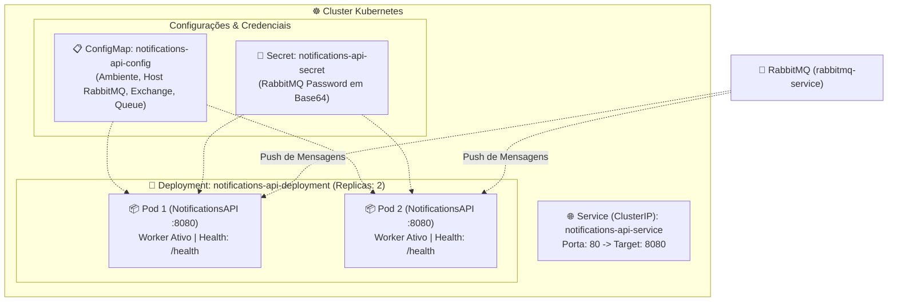

# NotificationsAPI - Documentação Técnica: Orquestração com Kubernetes (K8s)

Este documento detalha a arquitetura de orquestração em nuvem da **NotificationsAPI** (`fcg-fase-02--notifications`) em clusters **Kubernetes (K8s)**, atendendo aos padrões de mensageria assíncrona desacoplada da Fase 02.

---

## 📑 Sumário

- [1. Visão Geral da Topologia no Cluster](#1-visão-geral-da-topologia-no-cluster)
- [2. Estrutura de Manifestos (`/k8s`)](#2-estrutura-de-manifestos-k8s)
- [3. Segregação de Configurações: ConfigMap vs Secret](#3-segregação-de-configurações-configmap-vs-secret)
  - [3.1. `ConfigMap` (Parâmetros Públicos)](#31-configmap-parâmetros-públicos)
  - [3.2. `Secret` (Credenciais em Base64)](#32-secret-credenciais-em-base64)
- [4. Especificação do `Deployment`](#4-especificação-do-deployment)
  - [4.1. Réplicas e Processamento Paralelo](#41-réplicas-e-processamento-paralelo)
  - [4.2. Injeção de Variáveis via `envFrom`](#42-injeção-de-variáveis-via-envfrom)
  - [4.3. Sondas de Integridade (Readiness e Liveness Probes)](#43-sondas-de-integridade-readiness-e-liveness-probes)
  - [4.4. Limites e Requisições de Recursos (Resources)](#44-limites-e-requisições-de-recursos-resources)
- [5. Exposição de Rede com `Service` (ClusterIP)](#5-exposição-de-rede-com-service-clusterip)
- [6. Comandos Essenciais de Operação (`kubectl`)](#6-comandos-essenciais-de-operação-kubectl)
- [7. Navegação](#7-navegação)

---

## 1. Visão Geral da Topologia no Cluster

A **NotificationsAPI** é um serviço *stateless* que executa como worker reativo em segundo plano:



---

## 2. Estrutura de Manifestos (`/k8s`)

| Arquivo | Kind (Tipo) | Responsabilidade |
|---|---|---|
| **`01-configmap.yaml`** | `ConfigMap` | Exchange, fila e routing key do RabbitMQ (`notifications.user-created`) |
| **`02-secret.yaml`** | `Secret` | Senha de conexão do RabbitMQ em Base64 |
| **`03-deployment.yaml`** | `Deployment` | Réplicas (2), injeção `envFrom`, probes `/health` e recursos enxutos |
| **`04-service.yaml`** | `Service` | Endpoint interno estável (ClusterIP) na porta 80 |

---

## 3. Segregação de Configurações: ConfigMap vs Secret

### 3.1. `ConfigMap` (Parâmetros Públicos)
- `ASPNETCORE_ENVIRONMENT`: `"Production"`
- `RabbitMQ__HostName`: `"rabbitmq-service"`
- `RabbitMQ__Port`: `"5672"`
- `RabbitMQ__UserName`: `"guest"`
- `RabbitMQ__Exchange`: `"fcg.users.events"`
- `RabbitMQ__Queue`: `"notifications.user-created"`
- `RabbitMQ__RoutingKey`: `"user.created"`

### 3.2. `Secret` (Credenciais em Base64)
- `RabbitMQ__Password`: `guest` em Base64 (`Z3Vlc3Q=`).

---

## 4. Especificação do `Deployment`

### 4.1. Réplicas e Processamento Paralelo
Mantém `replicas: 2`. Ambas as réplicas mantêm o consumidor reativo `RabbitMqConsumerService` conectado à fila, dividindo o envio de e-mails em tempo real sem concorrência destrutiva (*Competing Consumers*).

### 4.2. Injeção de Variáveis via `envFrom`
Injeta as configurações e credenciais diretamente no ambiente do contêiner.

### 4.3. Sondas de Integridade (Readiness e Liveness Probes)
- **`readinessProbe`:** Testa `GET /health` na porta 8080 a cada 10s (`initialDelaySeconds: 5`).
- **`livenessProbe`:** Testa `GET /health` a cada 20s (`initialDelaySeconds: 15`).

### 4.4. Limites e Requisições de Recursos (Resources)
Por ser um worker leve de mensageria:
- **`requests`:** CPU `50m` e Memória `64Mi`.
- **`limits`:** CPU `200m` e Memória `128Mi`.

---

## 5. Exposição de Rede com `Service` (ClusterIP)

- **Tipo:** `ClusterIP`
- **Nome DNS Interno:** `notifications-api-service`
- **Mapeamento:** Porta 80 externa do serviço direcionada para a porta 8080 interna do contêiner.

---

## 6. Comandos Essenciais de Operação (`kubectl`)

```powershell
# Validação prévia de sintaxe (dry-run)
kubectl apply -f k8s/ --dry-run=client

# Aplicar manifestos
kubectl apply -f k8s/

# Monitorar Pods
kubectl get pods -l app=notifications-api

# Logs em tempo real do disparo de e-mails
kubectl logs -f -l app=notifications-api
```

---

## 7. Navegação

- ⬅️ **[Voltar para a Containerização Docker (`docker.md`)](docker.md)**
- 📑 **[Voltar para o Índice da Documentação (`index.md`)](index.md)**
